<h1></h1>

<strong>The official site for FDP Client builds, installation guides, and changelogs.</strong>

Website · <a href="https://fdpinfo.github.io/">fdpinfo.github.io</a> 
Latest builds · <a href="https://fdpinfo.github.io/download/">Forge</a> · <a href="https://fdpinfo.github.io/download/#inject">Inject</a> 
Discord · <a href="https://discord.gg/3XRFGeqEYD">Join the FDP Client community</a> 

## Installing FDP Client

Choose the Forge build or FDP Client Inject with ZAVZ. [Installation and download guide](docs/INSTALLING.md).

## Features

- **Build downloads** for Forge and FDP Client Inject, with SHA-256 checksums when available. [Downloads](https://fdpinfo.github.io/download/).
- **Guided setup** for each build, including a ZAVZ walkthrough for Inject. [Inject guide](https://fdpinfo.github.io/download/#install-inject).
- **Release notes** with build history and known issues. [Changelogs](https://fdpinfo.github.io/changelogs/).
- **Search and localization** with Ctrl/Cmd + K search and text in English, Portuguese, Spanish, Simplified Chinese, and Russian.
- **Related projects** maintained in their own repositories. [FDPClient source and releases](https://github.com/SkidderMC/FDPClient) · [ZAVZ source](https://github.com/opZywl/Zavz) · [ZAVZ downloads](https://lucas-lima.xyz/archives/zavz-inject).

## The staff team

[Website maintainer and project contacts](docs/TEAM.md).

## Issues

Describe the page or build, what happened, and how to reproduce it. For download or website help, start in the community. Report client or executor bugs in the corresponding repository. [Community](https://fdpinfo.github.io/community/) · [FDPClient issues](https://github.com/SkidderMC/FDPClient/issues) · [ZAVZ issues](https://github.com/opZywl/Zavz/issues).

## License

The website code and original assets are proprietary under the [website license](LICENSE). FDPClient and ZAVZ are distributed under their respective GPL-3.0 licenses. [FDPClient license](https://github.com/SkidderMC/FDPClient/blob/main/LICENSE) · [ZAVZ license](https://github.com/opZywl/Zavz/blob/main/LICENSE).

## Setting up a workspace

Use Node.js 22 and npm to run the site locally. [Workspace setup](docs/WORKSPACE.md).

## Contributing

Check the site in development, run the static build, and include screenshots for visual changes. [Contribution notes](docs/CONTRIBUTING.md) · [Build and deployment](BUILD.md) · [Architecture](docs/ARCHITECTURE.md).

 
Website designed and maintained by <a href="https://lucas-lima.xyz">Lucas Lima (Zywl)</a> · <a href="https://github.com/FdpInfo">FdpInfo on GitHub</a>

